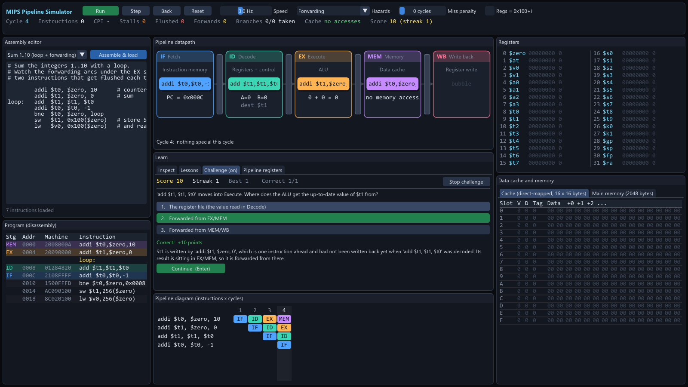

# MIPS Pipeline Simulator

An interactive tool for learning how a CPU works: a graphical, cycle-accurate simulator
of a 5-stage MIPS pipeline with a data cache, built with C++17, Dear ImGui and GLFW.

## Learning features

- **Click to inspect**: click any pipeline stage, pipeline register, CPU register or
  cache row to read what it is for and what it is doing in the current cycle.
- **Lessons**: six guided tours (the five stages, data hazards, forwarding, the
  load-use hazard, branches and flushing, the cache). Each loads a small program and
  clocks the pipeline to the next interesting event as you press Continue.
- **Challenge**: the clock stops before interesting cycles and asks you to predict
  what happens (branch taken? cache hit? forwarded from where? stall?). Right answers
  score points, streaks score more.



## Build and run (Windows, Visual Studio + CMake)

```
cmake -S . -B build
cmake --build build --config Release
build\Release\cpu_simulator.exe
```

The first configure downloads Dear ImGui and GLFW. Run the core tests with
`build\Release\core_tests.exe`.

## Settings

**File > Settings** (Ctrl+,) changes the text and interface size, the theme (midnight
blue, black or light), animations, how register values are shown, which panels are
visible and the run speed. Panels can also be toggled from the **View** menu.
Preferences and the challenge high score are saved to
`%APPDATA%\MIPS Pipeline Simulator\settings.ini`. **Help > About** shows the version.

## Controls

| Key | Action |
| --- | --- |
| Space | Run / pause |
| Right arrow or F10 | Step one clock cycle |
| Left arrow | Step back one cycle |
| Ctrl+Enter (in editor) | Assemble and load |
| Enter | Continue (lesson or challenge) |
| 1-4 | Answer a challenge question |
| Ctrl + / Ctrl - / Ctrl 0 | Larger / smaller / default text size |
| Ctrl+, | Settings |

## What it models

- **Pipeline**: IF, ID, EX, MEM, WB. Registers are written in the first half of a
  cycle and read in the second. Branches resolve in EX (predict not taken, two
  instructions flushed when taken); `j` resolves in ID (one flushed).
- **Hazards** (toolbar): *None* reads stale values, *Stall only* waits in ID,
  *Forwarding* bypasses from EX/MEM and MEM/WB and stalls once on load-use.
- **Cache**: direct-mapped, 16 slots of 16 bytes, write-back, in front of 2048
  bytes of memory (initialised to `address % 256`). An optional miss penalty
  freezes the whole pipeline.
- **Instructions**: `add sub and or xor nor slt sll srl addi slti andi ori xori lui
  lw sw lb lbu sb beq bne j`, pseudo `nop li move b`, and `.word` for raw machine code.
  Words are little-endian. Data addresses wrap at 2048.

## Layout

| File | Purpose |
| --- | --- |
| `src/isa.*` | Instruction fields, register names, disassembler |
| `src/assembler.*` | Two-pass assembler |
| `src/cache.*` | Data cache |
| `src/cpu.*` | Pipeline, hazard logic, per-cycle trace, undo |
| `src/learn.*` | Explanations, lessons and challenge questions |
| `src/ui.*`, `src/main.cpp` | Interface and window setup |
| `tests/core_tests.cpp` | Headless tests for the core |
